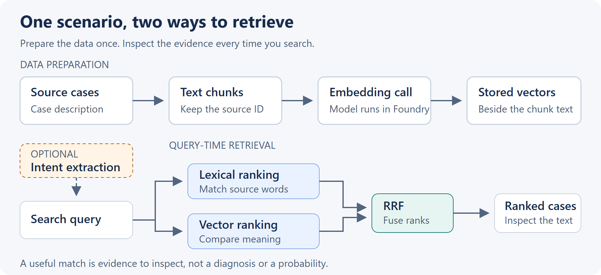

# Attendee guide

**One scenario. Four notebooks. From matching words to matching meaning.**

Follow 207 synthetic clinical cases through full-text search, model access,
chunking, semantic retrieval, and hybrid ranking. The final intent-extraction
exercise is optional; it is not required for core retrieval.

> [!IMPORTANT]
> The cases are synthetic. This is a retrieval demonstration, not medical
> advice, diagnosis, treatment guidance, or a clinical decision system.

## Follow the scenario

| Notebook | Your question | What you build or inspect |
|---|---|---|
| [1. Beyond Keywords](01-beyond-keywords.ipynb) | Why can matching words miss a relevant case? | Full-text retrieval, the semantic gap, and the external embedding model association. |
| [2. From Case Notes to Vectors](02-case-notes-to-vectors.ipynb) | How do we make case descriptions searchable by meaning? | Traceable chunks, an explicit embedding request, and stored vectors. |
| [3. Search by Meaning](03-search-by-meaning.ipynb) | Can different words retrieve the same concept? | Exact kNN, an approximate DiskANN index, and evidence of index use. |
| [4. From Narrative to Better Results](04-narrative-to-results.ipynb) | How do we combine search signals and focus a detailed request? | Reciprocal rank fusion (RRF) and optional intent-to-retrieval routing. |

The [session overview](../README.md) links directly to each notebook. Teaching
allocations total 75 minutes, including the optional five-minute exercise;
these allocations are not execution-time guarantees.

## Start on a prepared lab VM

The hosted environment should be prepared before participants sign in. The host
supplies the Windows VM and dedicated Azure resources; this repository does not
implement provider-specific VM provisioning or login automation.

1. Open the repository root in Visual Studio Code and select the **MSSQL** kernel.
2. Connect to the prepared `Healthcare` database with the assigned Microsoft
   Entra identity. Never use `master`, production data, or a shared database.
3. Open [Lab 1](01-beyond-keywords.ipynb) and run its read-only readiness check.
   Every required result must be **Yes**.
4. Run the notebooks in order, **one SQL cell at a time**. Do not use **Run All**.
5. Read the explanation before each cell and review its expected result.
   Variables do not persist between cells; database objects carry state forward.
6. Resolve every required **No** or **Skipped** checkpoint before proceeding.
   Checkpoints report missing state; they do not provision or repair it.

If a readiness check fails on a fresh VM, follow its diagnostic and contact the
facilitator. Do not bypass it by switching databases.

**Learn more:** [SQL notebooks in Visual Studio Code](https://learn.microsoft.com/en-us/sql/tools/visual-studio-code-extensions/mssql/mssql-sql-notebooks?view=sql-server-ver17).

## Learn at your own pace

Cloning the repository alone does not create the Azure environment. Review the
[host deployment guide](../infra/README.md) before creating resources. You need:

- Windows, Visual Studio Code, and the MSSQL extension.
- An Azure subscription and permissions to create the dedicated SQL and Foundry
  resources and role assignment.
- Azure CLI, Go sqlcmd with `--authentication-method ActiveDirectoryAzCli`, and
  PowerShell 7.2 or later for host setup.
- Regional availability and sufficient quota for the workshop's embedding
  model and, if using the optional exercise, its chat model.

The host prepares the database and managed-identity credential. Participants
register the external embedding model, build the retrieval structures, and
generate vectors themselves. Do not pre-create the full-text index, chunks,
embeddings, vector index, or retrieval procedure.

## Required starting state for lab hosts

Prepare a dedicated workshop environment, never a shared or production
database. See the [deployment guide](../infra/README.md) for the infrastructure,
desktop setup, and SQL initialization workflow.

At participant start, the environment must have:

- The `Healthcare` database on an Entra-only Azure SQL server; the participant
  connects with an assigned Microsoft Entra identity.
- The original `dbo.Cases`, `dbo.ComplaintEmbeddings`, and
  `dbo.SymptomEmbeddings` schema and exactly 207 synthetic source cases.
- The Foundry `text-embedding-3-small` deployment and SQL server
  system-assigned identity with inference permission.
- A database master key and one managed-identity credential associated with
  the actual Foundry resource endpoint.
- The optional `dbo.AI_GENERATE_RESPONSE` helper and `gpt-5-nano` deployment
  only if the host intends to support the last optional exercise.

The host preparation script does not pre-create this track's external model,
full-text index, chunks, embeddings, vector index, or retrieval procedure.
Participants own those exercises. Never derive the Foundry endpoint from the
SQL server name.

## Inspect evidence, not just successful execution

- **Lexical relevance:** compare `crushing chest pain` with
  `An elephant is standing on my torso`. Full-text ranks vary; review the
  matching text, not only the rank.
- **Chunk coverage:** every one of the 207 cases should have a chunk. The
  exercise uses an 800-character chunk size with 10 percent (80-character)
  overlap.
- **Embedding completeness:** the pending vector count must be zero. Reruns
  resume NULL vectors and preserve successful batches. Use the same embedding
  model for stored and query vectors.
- **Index usage:** inspect the actual execution-plan XML for **Vector Index Seek**.
  An existing index or plausible results do not prove DiskANN was used. If the
  selected engine cannot provide the indexed path, record that limitation.
- **Fusion arithmetic:** the deterministic RRF fixture ranks case 2 first at
  approximately `0.03252247`. Real retrieval displays lexical and vector ranks
  separately; it does not add incompatible raw scores.
- **Optional intent:** validate both the returned JSON and extracted meaning.
  The detailed example should preserve current chest pain while excluding
  denied fever, family history, and another person's symptoms. `Clarify` and
  `OutOfScope` must perform no retrieval.

The dataset is intentionally small. It teaches query shape and relevance, not
production-scale performance or guaranteed approximate recall. Completion
checkpoints inspect saved state; they do not establish relevance, model
connectivity, semantic quality, or index use.

## Costs, errors, and recovery

Azure resources and model inference can incur charges:

- The exercises make an embedding smoke request, up to one embedding request
  per pending chunk, and further requests when vector or hybrid searches run.
- Repeating a search makes another query-embedding request.
- The optional intent exercise makes one chat request and, for `SearchCases`,
  one query-embedding request.
- Read cost notices before execution. Do not repeat model or embedding cells
  without a reason.

The embedding loop preserves completed batches and resumes only NULL vectors.
Service and authentication errors stop visibly; resolve endpoint, identity,
quota, or service problems before retrying. The exercises do not silently
switch models, reuse cached model results, or hide errors with retries.

## Database objects and cleanup

The track reuses `dbo.Cases`, the database master key, the prepared managed-
identity credential, and the external embedding model it registers. It creates
the `RetrievalCatalog` catalog, a full-text index, `dbo.RetrievalChunks`, and
`dbo.RetrievalSearch`. It does not reset the original workshop's embedding
tables or procedures. Do not interleave reset operations from another lab.

For hosted environments, follow the provider's teardown instructions. If you
created the dedicated resource group yourself, delete only that group, wait for
deletion, and verify that it no longer exists. Never delete a host-owned or
shared group without authorization. Closing Visual Studio Code does not stop
resource charges.

## More information

- [Full-text search](https://learn.microsoft.com/en-us/sql/relational-databases/search/full-text-search)
- [Vector search in the SQL database engine](https://learn.microsoft.com/en-us/sql/relational-databases/vectors/vector-search)
- [Retrieval-augmented generation](https://learn.microsoft.com/en-us/azure/ai-services/openai/concepts/retrieval-augmented-generation)
